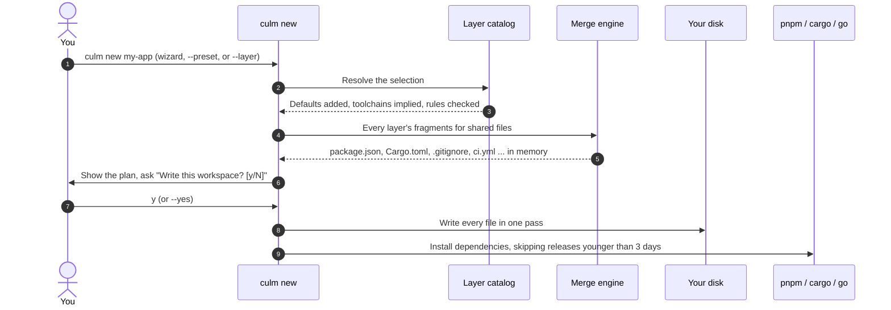
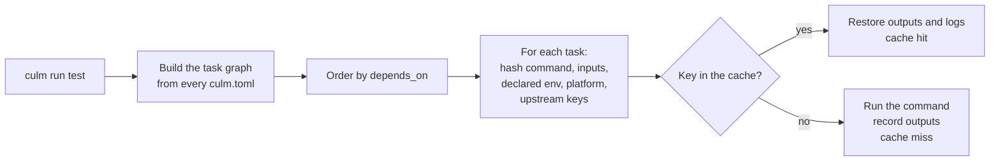
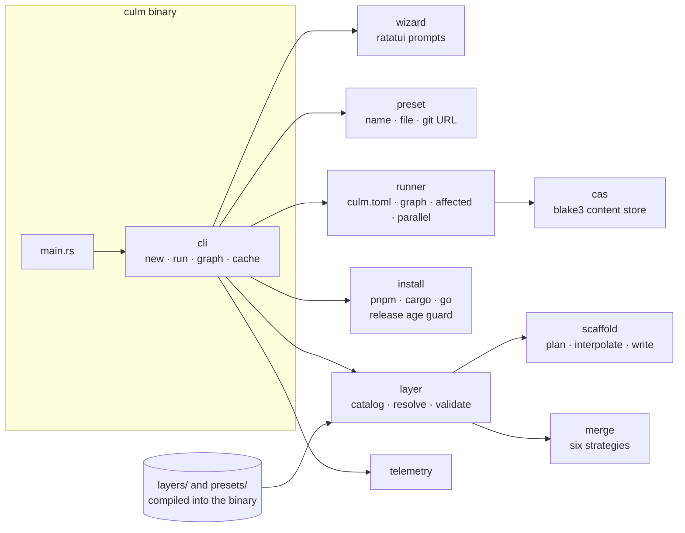

<p align="center">
  <picture>
    <source media="(prefers-color-scheme: dark)" srcset="docs/Logo/culm-wordmark-dark.png"/>
    
  </picture>
</p>

<h3 align="center">Workspace tooling for polyglot repositories.</h3>

<p align="center">
  Scaffold a workspace from composable layers · Run its tasks with a content-addressed cache<br/>
  <b>One Rust binary for repositories that are genuinely more than one language.</b>
</p>

<p align="center">
  <a href="./LICENSE"></a>
  
  <a href="https://crates.io/crates/culm"></a>
  
  
</p>

> **Status: pre-alpha.** culm is on [crates.io](https://crates.io/crates/culm),
> so `cargo install culm` is all it takes; the whole path is walked
> through step by step in [Your first workspace](#-your-first-workspace).
> The scaffolder is the most complete half. The runner works and caches,
> but is in its r0.2 checkpoint: two weeks of real use before anything
> else is built on it, so treat it as experimental.

**culm** (pronounced *kulm*) is the stalk of a grain plant, the
structure the grain grows on. Four characters, plain ASCII: the folder,
the repository, the binary, the npm package, the crate, and the domain
are all `culm`.

---

## 📖 Table of contents

- [What culm does](#-what-culm-does)
- [Features](#-features)
- [How it works](#-how-it-works)
- [Your first workspace](#-your-first-workspace), a step by step walkthrough
- [Running tasks](#-running-tasks), a step by step walkthrough
- [Command reference](#-command-reference)
- [Writing `culm.toml`](#-writing-culmtoml)
- [Environment variables](#-environment-variables)
- [Architecture](#-architecture)
- [Repository layout](#-repository-layout)
- [Rules worth knowing](#-rules-worth-knowing)
- [Working on culm](#-working-on-culm)
- [CI and releases](#-ci-and-releases)
- [Distribution](#-distribution)
- [Troubleshooting](#-troubleshooting)
- [Documentation](#-documentation)
- [Contributing](#-contributing)
- [Organisation](#-organisation)
- [Licence](#-licence)

## 🌱 What culm does

culm is two halves of one tool, shipped as one binary rather than two
products ([decision 1](docs/CONTEXT.md#decisions)).

- **The scaffolder (`culm new`)** stands up a workspace so you never
  again hand-wire prettier, eslint, rustfmt, clippy, tsconfig paths,
  ignore files, CI, and a workspace manifest at 11pm on day one. You pick
  layers (a framework, a database, a linter, a runner), and culm merges
  them into one consistent repository and installs the dependencies.
- **The runner (`culm run`)** knows what changed, skips what it can, and
  caches the rest by content, across a repository that holds more than
  one language.

### The gap it exists to fill

`create-nx-workspace` will not give you a Cargo workspace, a
`rustfmt.toml`, a `clippy.toml`, and a pre-commit hook that runs
`cargo fmt --check` on staged `.rs` files *and* `lint-staged` on staged
`.ts` files. `cargo-generate` will not give you the JavaScript half.
Neither will, because the JS tools are JS-first and the Rust tools are
Rust-first.

The same split shows up in the runner. A repository with a root
`Cargo.toml` next to a `pnpm-workspace.yaml` has two dependency graphs
and two lockfiles, and every existing task runner treats one of them as
the real one and the other as a plugin.

That is the whole thesis: **be correct about the polyglot case, which is
the case everyone else bolted on afterwards.**

### What you can scaffold today

| Category | Choose | Layers |
| --- | --- | --- |
| shape | exactly one | `single-app`, `monorepo`, `tooling-only` |
| frontend | depends on shape | `astro`, `next`, `nuxt`, `react-vite`, `svelte`, `vue-vite` |
| backend | depends on shape | `actix`, `axum`, `express`, `fastify`, `go-chi`, `nestjs` |
| data | zero or more | `drizzle`, `prisma`, `sqlx` |
| toolchain | filled in for you | `node-pnpm`, `rust-cargo`, `go-mod` |
| quality | zero or more, some on by default | `clippy`, `commitlint`, `editorconfig`, `eslint`, `husky`, `prettier`, `rustfmt` |
| infra | zero or more | `docker-compose`, `dockerfile`, `github-actions` |
| editor | zero or more | `vscode`, `zed` |
| runner | exactly one | `none`, `nx`, `turborepo`, `moon`, `culm` |
| base | always | `base` |

Every layer, what it contributes, and how to write your own:
[docs/LAYERS.md](docs/LAYERS.md).

## ✨ Features

Everything here is implemented in `src/` and covered by tests.

### 🧩 Scaffolding

- **39 layers across ten categories.** Every application layer is
  verified by a real install and build, in both `single-app` and
  `monorepo` shapes.
- **Three ways to choose**: an interactive wizard, presets (built in, a
  local file, or a git URL), or `--layer` flags for scripts and CI.
- **The selection is checked before anything happens.** Each category
  has rules that depend on the shape, and a contradiction (a frontend in
  a `tooling-only` workspace) is an error, not a half-built repository.
- **Toolchains are implied**: pick `next` and `node-pnpm` arrives.
- **`--save-preset`** writes your exact selection to a file you can
  reuse or share.

### 🔀 Merging shared files

- **Six merge strategies** for the files every layer wants a say in:
  `package.json`, `Cargo.toml`, `.gitignore`, `pnpm-workspace.yaml`, CI
  workflows, and git hooks.
- **Order independent**, proven by a property test over every
  permutation of a generated layer set: the same layers always produce
  the same bytes.
- **Collisions are errors that name both layers** and the exact key,
  never last-write-wins.

### 📦 Installing

- **Real package managers** (pnpm, cargo, go) install real, current
  versions. No layer template pins a version.
- **A release age guard** skips any version published in the last 3
  days, a defence against freshly compromised packages.
- **`--no-install`** prints the exact commands instead, for offline or
  audited setups.

### 🏃 Running tasks

- **A content-addressed cache** keyed on the command, input file hashes,
  declared environment variables, platform, and upstream keys.
- **`--affected <REF>`** runs only what changed since a git ref,
  including uncommitted work, plus everything downstream.
- **`--parallel`** runs independent tasks at the same time.
- **`--verify`** reruns for real and fails on any mismatch with the
  cache, so a wrong cache hit cannot hide.
- **Multi-project workspaces**: one `culm.toml` per project, tied
  together by a root `[workspace]`.
- **No lock-in**: the scaffolder can just as well write Nx, Turborepo,
  or Moon configuration, or none.

### 🔒 Safety

- **Nothing is half-written.** The whole workspace is planned in memory
  and only written once everything validates.
- **A layer cannot write outside the workspace.** Absolute paths and
  `..` are refused.
- **`#![forbid(unsafe_code)]`** in the library and the binary.
- **Telemetry prints its exact payload** on first run, before you rely
  on anything, and is off in CI, under `DO_NOT_TRACK=1`, or with
  `CULM_TELEMETRY=0`.

## ⚙️ How it works

### `culm new`



Nothing touches disk until the whole selection has been validated and
merged in memory. A conflict between two layers is an error that names
both of them, never a silent last-write-wins.

### `culm run`



Only tasks marked `cache = true` are cached. Everything else runs every
time.

## 🚀 Your first workspace

This walkthrough takes you from nothing to a running, tested Rust API.
Every output block below is copied from a real run, with long paths
shortened.

### Prerequisites

- **Rust**, latest stable, via rustup (step 1)
- **git**, to get the source
- **Node and pnpm**, or **Go**, only if you pick JavaScript or Go layers
  (step 2)

### Step 1. Install Rust

culm is installed with Cargo, Rust's package manager, so you need Rust.
If `cargo --version` already prints a version, run `rustup update` to
get the latest stable and skip to step 2.

**Linux and macOS:**

```bash
curl --proto '=https' --tlsv1.2 -sSf https://sh.rustup.rs | sh
```

Accept the defaults, then **open a new terminal** so `cargo` is on your
`PATH`.

**Windows:** download and run `rustup-init.exe` from
[rustup.rs](https://rustup.rs/), then open a new terminal.

Check it worked:

```bash
cargo --version
```

### Step 2. Install the tools your layers will use

culm runs the real package managers to install dependencies, so you
need the ones for the layers you pick:

| If you pick | You need | Check with |
| --- | --- | --- |
| Rust layers (`axum`, `actix`, `sqlx`, `clippy`, ...) | Rust, from step 1 | `cargo --version` |
| JavaScript layers (`next`, `nuxt`, `nestjs`, `eslint`, ...) | Node (current LTS) and pnpm | `node --version`, `pnpm --version` |
| Go layers (`go-chi`) | Go | `go version` |
| `--affected`, a preset from a git URL, or installing from source | git | `git --version` |

Not sure yet? Install nothing extra for now. The walkthrough below only
uses Rust, and `--no-install` (step 5) skips installs entirely.

### Step 3. Install culm

```bash
cargo install culm
```

Cargo downloads culm from crates.io and compiles it, which takes a
minute or two the first time. When it finishes, `culm` is installed into
`~/.cargo/bin`, which rustup already put on your `PATH`.

Check it worked, from any directory:

```bash
culm --version
```

```
culm 0.1.1
```

To upgrade later, run `cargo install culm` again. To remove it,
`cargo uninstall culm`.

<details>
<summary>Installing from source instead (to try unreleased changes)</summary>

```bash
git clone https://github.com/Zunetra/culm.git
cd culm
cargo install --path .
```

Inside the checkout, `cargo culm <args>` runs culm without installing
it: it is an alias for `cargo run --quiet --` (see `.cargo/config.toml`).
Anything it scaffolds lands inside the checkout, so prefer the
installed `culm` for real projects.

</details>

### Step 4. Move to where your projects live

`culm new` creates a new folder **inside your current directory**, so
`cd` to wherever you keep your work first:

```bash
cd ~/Projects        # or wherever you keep your work
```

### Step 5. Scaffold a workspace

There are three ways to choose what goes in it. Pick one.

**Option A, the wizard (easiest the first time):**

```bash
culm new my-app
```

The wizard asks one question per screen, in this order: shape, frontend,
backend, database, (toolchain, only for `tooling-only`), quality, infra,
editor, runner. The database screen only offers what fits the apps you
picked (`sqlx` beside a Rust service, `prisma` and `drizzle` beside a
Node one), and is skipped when you picked no app.

| Key | Does |
| --- | --- |
| `↑` / `↓` (or `k` / `j`) | Move |
| `Space` | Tick or untick, on screens where you can choose several |
| `Enter` | Confirm this screen |
| `Esc` or `q` | Cancel. Nothing is written |

**Option B, a preset:**

```bash
culm new my-app --preset backend
```

| Preset | What you get |
| --- | --- |
| `backend` | A single Rust API on Axum |
| `frontend` | A single Nuxt application |
| `monorepo` | A Nuxt front end and an Axum service backed by SQLx |

Add `--layer` to put more on top of a preset:

```bash
culm new my-app --preset backend --layer data/sqlx --layer runner/culm
```

**Option C, layers by hand** (what this walkthrough uses):

```bash
culm new my-app --layer shape/single-app --layer backend/axum --layer runner/culm
```

Each `--layer` is `<category>/<id>`, from the table in
[What you can scaffold today](#what-you-can-scaffold-today). You do not
have to list toolchains or default quality layers: culm adds them for
you and shows you exactly what it added.

Whichever option you chose, culm prints the full plan and asks before
writing anything:

```
7 layers:
  backend/axum
  base/base
  quality/clippy
  quality/rustfmt
  runner/culm
  shape/single-app
  toolchain/rust-cargo

8 files copied, 4 files merged

Write this workspace? [y/N]
```

Type `y` and press `Enter`. culm writes the files, then installs
dependencies:

```
Scaffolded my-app into ~/Projects/my-app

Installing dependencies:
  cargo add --manifest-path crates/axum/Cargo.toml axum@0.8.9 serde_json@1.0.154 thiserror@2.0.21
  cargo add --manifest-path crates/axum/Cargo.toml --features full tokio@1.54.1
  cargo add --dev --manifest-path crates/axum/Cargo.toml tower@0.5.3 http-body-util@0.1.5
```

The very first time you run culm, it also prints the anonymous usage
data it sends, as exact JSON, and how to turn it off
(`CULM_TELEMETRY=0`). See [Environment variables](#-environment-variables).

Notice the exact versions: culm picks them itself, and never one
released in the last 3 days. That is a supply-chain guard; change it
with `--min-release-age <DAYS>`, or `0` to turn it off.

**Useful flags for this step:**

| Flag | Use it when |
| --- | --- |
| `--yes` | You do not want the `[y/N]` question. **Required in CI** and in scripts, where there is no one to answer it |
| `--no-install` | You want the files only. culm prints the install commands instead of running them, so you can run them yourself later |
| `--without <category>/<id>` | You want to drop a layer that would be added by default, such as `--without quality/clippy` |
| `--save-preset <NAME>` | You want to reuse this exact selection. culm writes `<NAME>.toml` here; next time, `--preset ./<NAME>.toml` |

### Step 6. Look at what you got

```bash
cd my-app
```

```
my-app/
├── Cargo.toml              # Cargo workspace, members merged from every Rust layer
├── Cargo.lock
├── clippy.toml             # from quality/clippy
├── rustfmt.toml            # from quality/rustfmt
├── culm.toml               # [workspace], from runner/culm
├── .env.example
├── .gitignore              # one block per layer that needs ignores
├── .github/workflows/ci.yml
└── crates/axum/
    ├── Cargo.toml
    ├── culm.toml           # this app's tasks: dev, build, test
    ├── src/{main,lib,config,error}.rs
    └── tests/health.rs
```

culm does not create a git repository for you. Make one now; you will
want it for `--affected` later:

```bash
git init
git add -A
git commit -m "chore: scaffold with culm"
```

### Step 7. Prove it builds

```bash
cargo test
```

The `axum` layer ships with real tests, and they pass out of the box:

```
running 2 tests
test an_unknown_path_returns_the_shared_error_body ... ok
test health_reports_ok ... ok

test result: ok. 2 passed; 0 failed
```

You now have a working workspace. If you chose `runner/culm`, carry on
to [Running tasks](#-running-tasks). If you chose `nx`, `turborepo`, or
`moon`, culm already wrote that tool's config; use that tool as you
normally would.

## 🏃 Running tasks

This continues from step 7 above, inside `my-app`, and only applies if
you chose `runner/culm`.

> The runner is experimental until its r0.2 checkpoint closes. Use
> `--verify` freely; it is how wrong cache hits get caught.

### Step 1. See what tasks exist

```bash
culm graph
```

```
crates/axum:dev
crates/axum:build
crates/axum:test
```

Tasks are named `<project>:<task>`. A project is any folder with its own
`culm.toml`, and the root `culm.toml` (the one with `[workspace]`) ties
them together. `culm graph --format dot | dot -Tsvg > graph.svg` draws
it, if you have Graphviz.

### Step 2. Run a task

```bash
culm run test
```

culm runs `build` first, because `test` declares `depends_on =
["build"]`. Each task prints one line before its own output:

```
> crates/axum:build (cargo build)
> crates/axum:test (cargo test) [cache miss]
...
1 cached task(s): 0 from cache, 1 run
```

`[cache miss]` means culm ran the command and stored its result.

### Step 3. Run it again, and watch the cache

```bash
culm run test
```

```
> crates/axum:build (cargo build)
> crates/axum:test (cargo test) [cache hit]
1 cached task(s): 1 from cache, 0 run
```

`test` did not run. culm saw that nothing it depends on had changed and
replayed the stored output instead. (`build` ran again because the
scaffolded `build` task is not marked `cache = true`.)

### Step 4. Change something

Edit any file under `crates/axum/src/` and run it a third time:

```
> crates/axum:test (cargo test) [cache miss]
1 cached task(s): 0 from cache, 1 run
```

The input changed, so the key changed, so `test` ran for real.

### Step 5. Everything else you will reach for

```bash
culm run test --parallel          # run independent tasks at the same time
culm run test --no-cache          # run for real, read and write no cache
culm run test --verify            # run for real AND fail if the result differs from the cache
culm run --affected main          # only tasks whose inputs changed since main, plus what depends on them
culm cache stats                  # e.g. "3 objects, 1636 bytes, at ~/.cache/culm/cas"
culm cache clear                  # empty the cache; the next run of every task is a miss
```

> **How `--affected` treats long-running tasks:** a task with no `inputs`
> always counts as affected, because guessing "unaffected" is the
> dangerous direction. A task marked `persistent = true`, like the
> scaffolded `dev` server, is never picked by `--affected`. Run it by
> name with `culm run dev`.

Run `culm run` from the workspace root to run a task in every project
that has it. Run it inside a project folder to run only that project's.

## 📟 Command reference

Run any command with `--help` for the full text.

| Command | What it does |
| --- | --- |
| `culm new <PROJECT>` | Scaffold a workspace into `./<PROJECT>`. Refuses a folder that exists and is not empty |
| `culm run [TASK]` | Run a task and everything it `depends_on`, using the cache |
| `culm graph` | Print the task graph |
| `culm cache stats` / `culm cache clear` | Inspect or empty the local cache |

### Exit codes

| Code | Meaning |
| --- | --- |
| `0` | Success. Also when you answer `N` to "Write this workspace?", since declining is not an error |
| `1` | Any failure: invalid selection, merge conflict, failed install, unknown task, a task's command failing, or a `--verify` mismatch. The reason is printed as `error: ...` on stderr |
| `2` | The command line itself was invalid, such as an unknown flag |

### `culm new`

| Flag | Meaning |
| --- | --- |
| `--layer <ID>` | Include a layer, as `<category>/<id>`. Repeat for several |
| `--preset <NAME>` | Start from a preset. Any `--layer` given as well is added on top |
| `--without <ID>` | Drop a layer that would otherwise arrive as a default |
| `--yes` | Skip the confirmation. Required when there is no terminal |
| `--no-install` | Write files, print install commands instead of running them |
| `--min-release-age <DAYS>` | Never install a release younger than this. Default `3`, `0` turns it off |
| `--save-preset <NAME>` | Save the resolved selection as `<NAME>.toml` in the current directory |
| `--layers-dir <PATH>` | Read layers from a folder instead of the ones built in. For authoring layers |

`--preset` accepts four forms:

| Form | Example |
| --- | --- |
| A first-party name | `--preset monorepo` |
| A local file | `--preset ./team.toml` |
| GitHub or GitLab shorthand, optional path and ref | `--preset github:acme/presets/api.toml@v1` |
| A full git URL (reads `preset.toml` on the default branch) | `--preset https://git.example.com/acme/presets.git` |

A remote preset is only ever a list of layer names. No file or script is
downloaded into your workspace from it.

### `culm run`

| Flag | Meaning |
| --- | --- |
| `--affected <REF>` | Instead of naming a task, run tasks affected by changes since `REF` (committed or not), plus everything downstream |
| `--parallel` | Run independent tasks concurrently, level by level |
| `--no-cache` | Run everything for real, read and write no cache |
| `--verify` | Run everything for real, fail if a cacheable task's output differs from its cache entry |
| `--cache-dir <PATH>` | Use this folder as the cache |
| `--config <PATH>` | Read this `culm.toml` instead of the one in the current directory |

### `culm graph` and `culm cache`

| Command | Meaning |
| --- | --- |
| `culm graph --format list` | One task per line, in a valid run order (the default) |
| `culm graph --format dot` | Graphviz DOT, for `dot -Tsvg` |
| `culm cache --root <PATH> stats` | Use a cache folder other than the default. Note `--root` comes before `stats` / `clear` |

## 📝 Writing `culm.toml`

`culm new --layer runner/culm` writes these for you. You only need this
section to add or change tasks.

**The root `culm.toml`** marks the workspace. It is just:

```toml
[workspace]
```

**Each project's `culm.toml`** declares its tasks:

```toml
[project]
dependencies = ["libs/ui"]          # other projects, by path from the root

[tasks.build]
command = "pnpm run build"
inputs = ["src/**/*", "package.json", "../../pnpm-lock.yaml"]
outputs = ["dist/**"]
depends_on = ["^build"]             # build in every project under [project].dependencies
cache = true

[tasks.test]
command = "cargo test"
inputs = ["**/*", "../../Cargo.lock"]
depends_on = ["build"]
cache = true
declared_env = ["RUSTFLAGS"]

[tasks.dev]
command = "pnpm run dev"
persistent = true                   # a server that never exits
```

| Field | Default | Meaning |
| --- | --- | --- |
| `command` | required | The shell command, run in the project's folder |
| `inputs` | none | Globs, relative to the project. Their contents are part of the cache key. **No inputs means "always affected"** |
| `outputs` | none | Globs of files the task produces. Stored on a miss, restored on a hit |
| `depends_on` | none | `"build"` (same project), `"libs/ui:build"` (a named project), or `"^build"` (every dependency project) |
| `cache` | `false` | Whether this task is cached at all |
| `declared_env` | none | Environment variables whose values are part of the key. Nothing else from the environment is |
| `persistent` | `false` | A long-running task, such as a dev server. `--affected` never selects it; `culm run <task>` still runs it. Added in 0.1.1; 0.1.0 ignores it |

**What goes into the cache key:** the task name, the command, the hash
of every input file, the declared environment variables, the OS and
architecture, and the key of every task it depends on. Change any of
those and the task runs. The cache lives in your OS cache folder
(`~/.cache/culm/cas` on Linux, `~/Library/Caches/culm/cas` on macOS),
never inside your workspace.

Full design: [docs/DESIGN.md section 3](docs/DESIGN.md).

## 🌍 Environment variables

All optional. Using culm needs none of them. To set them while working
on culm itself, start from the example file in the repository root:

```bash
cp .env.example .env              # then edit .env
set -a && . ./.env && set +a      # load it into this shell; culm does not read .env itself
```

`.env.example` documents each variable, and `.env` is gitignored. The
telemetry receiver has its own, `telemetry/worker/.env.example`; see
[docs/DEPLOY.md](docs/DEPLOY.md).

```bash
# Telemetry is on by default. 0, false, off, or no turns it off.
# 1, true, on, or yes turns it on even in CI.
CULM_TELEMETRY=0

# The cross-tool opt out. 1 turns culm's telemetry off.
DO_NOT_TRACK=1

# Set by every CI provider. Turns telemetry off unless CULM_TELEMETRY
# is 1, true, on, or yes.
CI=true

# Send telemetry to another receiver, for testing one.
CULM_TELEMETRY_ENDPOINT=http://localhost:8787/events

# Hide the start-up banner. NO_COLOR does the same, whatever its value,
# and the banner is always hidden when output is piped.
CULM_NO_BANNER=1
NO_COLOR=1
```

**About telemetry.** culm sends anonymous usage data to help decide
which layers to build next. The first time it does, it prints the exact
JSON it sends and how to turn it off: `CULM_TELEMETRY=0` or
`DO_NOT_TRACK=1`, and it is already off in CI. It sends an anonymous
machine id, the culm
version, OS and architecture, the command, and which layers and preset
were chosen. It never sends repository names, file paths, task names,
commands, environment values, or git remotes. The full payload is in
[docs/TELEMETRY.md](docs/TELEMETRY.md). Sending never delays a command
by more than half a second, and a failed send is silent.

## 🏛️ Architecture



| Module | Responsibility |
| --- | --- |
| `layer` | Loads every `layer.toml`, adds defaults and implied toolchains, and checks the selection against each category's rules for the chosen shape |
| `merge` | Combines fragments from many layers into one shared file. Six strategies: `json-deep`, `line-block`, `toml-members`, `yaml-list`, `yaml-steps`, `hook-script`. Order independent, proven by a proptest |
| `scaffold` | Plans each layer's own files in memory, fills in `{{project_name}}`, refuses any path that escapes the workspace, then writes everything in one pass |
| `install` | Turns each layer's `[[install]]` entries into pnpm, cargo, and go commands, choosing versions old enough to pass the release age guard |
| `runner` | Reads `culm.toml` files, builds the task graph, works out what is affected, runs tasks in order or in parallel, and writes Nx, Turborepo, and Moon config for those runner layers |
| `cas` | The content-addressed store behind the cache: files stored under their blake3 hash |
| `wizard`, `preset`, `telemetry`, `banner` | The interactive prompts, preset loading, the published telemetry payload, and the banner |

Errors in the core modules (`layer`, `merge`, `scaffold`, `cas`) are
`thiserror` types. `anyhow` is used only at the command boundary:
`main.rs`, `cli/`, `wizard/`, and `runner/registration.rs`. Both
`src/lib.rs` and `src/main.rs` carry `#![forbid(unsafe_code)]`.

How the merge engine and scaffold pipeline work inside:
[docs/INTERNALS.md](docs/INTERNALS.md).

## 📁 Repository layout

```
culm/
├── src/
│   ├── main.rs                    # Binary entry point: new, run, cache, graph
│   ├── lib.rs                     # Crate root, forbids unsafe, declares the modules
│   ├── banner.rs                  # Terminal banner, silenced by NO_COLOR or CULM_NO_BANNER
│   ├── cli/                       # One file per command, each callable from a test
│   ├── wizard/                    # The ratatui prompts
│   ├── preset/                    # First-party, file, and git URL presets
│   ├── layer/                     # The layer format: catalog, resolve, validate
│   ├── merge/                     # The merge engine, one file per strategy
│   ├── scaffold/                  # Copy plan, {{name}} interpolation, the one disk write
│   ├── install/                   # pnpm, cargo, go installs and the release age guard
│   ├── runner/                    # culm.toml, task graph, cache, affected, parallel,
│   │                              #   remote cache client, nx/turborepo/moon writers
│   ├── cas/                       # Content-addressed store, blake3
│   └── telemetry/                 # The published payload and the sender
├── layers/<category>/<id>/        # The 39 shipped layers, compiled into the binary
├── presets/                       # backend, frontend, monorepo
├── tests/
│   ├── cli.rs                     # Drives the commands end to end
│   ├── layers.rs                  # Every shipped layer, found by walking layers/
│   ├── scaffold.rs                # End-to-end scaffolds into a temporary directory
│   ├── order_independence.rs      # Proptest: any layer order renders identical bytes
│   └── cache_correctness.rs       # Compares restored bytes, not "cache hit" log lines
├── docs/
│   ├── CONTEXT.md                 # Every settled decision and convention. Read first
│   ├── DESIGN.md                  # How both halves work, and what is left
│   ├── LAYERS.md                  # The layer model, every shipped layer, authoring
│   ├── INTERNALS.md               # The merge engine, scaffold pipeline, library use
│   ├── TELEMETRY.md               # The exact telemetry payload
│   ├── DEPLOY.md                  # Releasing culm and deploying the telemetry receiver
│   └── Logo/                      # The culm marks
├── telemetry/worker/              # The telemetry receiver, a Cloudflare Worker and D1
├── npm/                           # npm launcher and platform package staging
├── packaging/homebrew/            # Formula template for the tap
├── installer.sh                   # Shell installer, verifies SHA256SUMS
├── .env.example                   # Optional environment for working on culm; cp to .env
├── .cargo/config.toml             # cargo culm and cargo lint aliases
├── .github/workflows/             # ci, templates (weekly), release
├── deny.toml                      # cargo deny policy
├── Cargo.toml                     # One crate, edition 2024
└── LICENSE                        # MIT
```

Two layout rules from [docs/CONTEXT.md](docs/CONTEXT.md):

- **culm is a single crate**, not a Cargo workspace. Splitting a module
  into a crate later is mechanical; un-splitting a premature workspace is
  not.
- **A module is a directory with a `mod.rs`** that declares and
  re-exports and holds no logic of its own.

## 📌 Rules worth knowing

These catch people out. The reasons are in
[docs/CONTEXT.md](docs/CONTEXT.md).

- **culm never locks you into culm.** The scaffolder must be able to
  emit Nx, Turborepo, Moon, or no runner at all, and never configuration
  only culm's runner understands.
- **No version numbers in layer templates.** Package managers write
  versions at install time; a test fails if a shipped layer pins one.
- **No combination of layers is ever written by hand.** Layers compose
  through the merge engine. A special case for one specific pair is how
  scaffolders rot.
- **Conflicts are errors, never last-write-wins.** If two layers set
  the same key to different values, culm stops and names both.
- **Nothing is half-written.** The whole workspace is validated in
  memory first, and a failure leaves your disk untouched.
- **A layer cannot write outside the workspace.** Absolute paths and
  `..` are refused, with no flag to allow them.
- **Only toolchains and default quality layers are added for you.**
  culm adds `node-pnpm` for a Next.js app and `clippy` for a Rust one,
  but will never pick your framework or database.

## 🛠️ Working on culm

### Prerequisites

Rust with edition 2024 support, via [rustup](https://rustup.rs/).
Nothing else: no system packages, database, or container. Node and pnpm
are only needed to run the optional `pnpm` scripts.

Optional environment, for example to turn telemetry off while you work,
or to point it at a receiver you are testing:

```bash
cp .env.example .env
set -a && . ./.env && set +a
```

### Commands

Use whichever column you prefer; they run the same thing.

| cargo | pnpm | What it does |
| --- | --- | --- |
| `cargo build` | `pnpm build` | Build the library and the `culm` binary |
| `cargo build --release` | `pnpm build:release` | Optimised build into `target/release/culm` |
| `cargo culm <args>` | `pnpm start <args>` | Run culm from source, e.g. `cargo culm new demo --preset backend --yes` |
| `cargo check --all-targets` | `pnpm check` | Fast type check, including tests |
| `cargo test` | `pnpm test` | Every unit and integration test |
| `cargo lint` | `pnpm lint` | **The gate:** `cargo clippy --all-targets -- -D warnings` |
| `cargo fmt` | `pnpm format` | Format |
| `cargo fmt --check` | `pnpm format:check` | Fail instead of rewriting, as CI does |
| `cargo install --path .` | | Install your local build as `culm`, replacing the crates.io one |

Single test suites:

```bash
cargo test --test layers               # every shipped layer
cargo test --test scaffold             # end-to-end scaffolds
cargo test --test order_independence   # the merge proptest
cargo test --test cache_correctness    # the runner's cache
cargo test --test cli                  # the commands, end to end
```

### Before every commit

```bash
cargo test
cargo lint
cargo fmt --check
```

All three run in CI, and CI fails on any of them. `--all-targets` in the
lint matters: test code is where warnings otherwise pile up unseen.

### Trying a layer change

Build the binary once, then scaffold from your working copy of `layers/`
into a throwaway folder:

```bash
cargo build
cd /tmp
~/path/to/culm/target/debug/culm new trial \
  --layers-dir ~/path/to/culm/layers \
  --layer shape/single-app --layer backend/axum --yes --no-install
```

The full guide to writing a layer, with a worked example, is in
[docs/LAYERS.md](docs/LAYERS.md#-authoring-a-layer).

### Test layout

- **Unit tests sit beside the code they test**, in a `#[cfg(test)] mod
  tests` under a `// === Tests` heading.
- **Cross-module behaviour goes in `tests/`**, where the crate is used
  the way a caller would use it.
- `tests/order_independence.proptest-regressions` holds seeds for
  failures proptest has already found. It is committed on purpose: a
  shrunk counterexample is worth more than the run that produced it.

### Code conventions

Full detail in [docs/CONTEXT.md](docs/CONTEXT.md). The ones that bite
first:

- **Ordinary comments use `/* ... */`, not `//`.** Bare `//` lines are
  never stacked.
- **`// === Section` is the top-level divider**, `// == Subsection`
  below it, and `// = ` below that and rare.
- **Doc comments are one sentence per line**, broken at the full stop,
  so a diff touching one sentence touches one line.
- **An explicit `return` is house style**, which is why
  `clippy::needless_return` is allowed in `Cargo.toml`.
- **No em dash** in any comment, commit message, document, or PR
  description.

## 🔁 CI and releases

| Workflow | Runs | What it proves |
| --- | --- | --- |
| [`ci.yml`](.github/workflows/ci.yml) | Every push and pull request | Formatting, clippy, tests, `cargo deny`, `cargo audit`, `cargo publish --dry-run`, a release build, and tests on macOS and Windows |
| [`templates.yml`](.github/workflows/templates.yml) | Weekly | The shipped layers still scaffold, install, and build against today's framework releases |
| [`release.yml`](.github/workflows/release.yml) | A `v*.*.*` tag, or by hand | Builds five binaries (Linux x64 and arm64, macOS x64 and arm64, Windows x64), attaches them with `SHA256SUMS` and `installer.sh` to a GitHub release |

**Cutting a release, step by step:**

1. Make sure CI is green on `main`, and `version` in `Cargo.toml` is the
   version you are releasing.
2. Tag and push the tag:
   ```bash
   git tag -s v0.1.1 -m "v0.1.1"
   git push origin v0.1.1
   ```
   This alone builds the binaries and creates the GitHub release. It
   publishes nothing to any registry.
3. To publish, open **Actions → release → Run workflow**, choose the tag,
   and set `publish` to `crates`, `npm`, `homebrew`, or `all`. Each
   channel needs its secret set in the repository first:

   | Channel | Secret |
   | --- | --- |
   | crates.io | `CARGO_REGISTRY_TOKEN` |
   | npm | `NPM_TOKEN` |
   | Homebrew | `HOMEBREW_TAP_TOKEN`, plus the `zunetra/homebrew-tap` repository |

Publishing is never automatic. A crates.io release cannot be deleted,
only yanked, so step 3 is deliberate.

## 📦 Distribution

> **crates.io is live; the other three are not yet.** The code for
> every channel is in this repository, but the npm packages, the
> Homebrew tap, and a tagged GitHub release with binaries do not exist
> yet. Until they do, use `cargo install culm`.

| Channel | Command | Audience | In this repository |
| --- | --- | --- | --- |
| npm | `npx culm@latest new` | Primary funnel, zero install | `npm/` |
| crates.io (**live**) | `cargo install culm` | Rust-native developers | `Cargo.toml` |
| Shell | `curl -fsSL https://github.com/Zunetra/culm/releases/latest/download/installer.sh \| sh` | CI and Docker | `installer.sh` |
| Homebrew | `brew install zunetra/tap/culm` | macOS and Linux | `packaging/homebrew/` |

The Rust binary is the product. The npm package is a launcher shipping
prebuilt binaries as platform-specific `optionalDependencies` with `os`
and `cpu` fields, the pattern esbuild, Biome, `@swc/core`, and Rspack
use. The package manager installs exactly one. The shell installer
verifies every download against the release's `SHA256SUMS` before
installing it.

**Not a postinstall downloader.** Those break under `--ignore-scripts`,
offline CI, corporate proxies, and sandboxed environments. See
[decision 8](docs/CONTEXT.md#decisions).

Both `culm` and `create-culm` were checked clean on npm, crates.io, and
the `.dev` domain on 2026-08-04, and are recorded in the handbook's
[reserved names](../handbook/naming/RESERVED.md). Availability changes,
so re-verify before relying on it.

What is built and what is left: [docs/DESIGN.md section 5](docs/DESIGN.md#5-status).

## 🔧 Troubleshooting

### Using culm

#### `culm: command not found`

`~/.cargo/bin` is not on your `PATH`. Open a new terminal after
installing Rust. If it still fails, add
`export PATH="$HOME/.cargo/bin:$PATH"` to your `~/.bashrc` or
`~/.zshrc`, then open a new terminal.

#### `error: .../my-app already exists and is not empty`

`culm new` never writes into a folder that has files in it. Pick another
name, or delete the folder first.

#### `Write this workspace? [y/N] Nothing was written.`

culm asked for confirmation and got no answer, which is what happens in
CI or a script. Add `--yes`.

#### `pnpm: command not found` (or `go`) during install

You picked a layer whose package manager is not installed. Install it
(see [step 2](#step-2-install-the-tools-your-layers-will-use)), then
either run the printed commands yourself or delete the folder and
scaffold again.

#### `error: .../culm.toml: No such file or directory`

`culm run` looks for `culm.toml` in the current directory. `cd` into
your workspace, or pass `--config <path>`. If the workspace has no
`culm.toml` at all, it was scaffolded with a different runner layer.

#### ``error: task `x` is not defined in .../culm.toml``

Run `culm graph` to see the task names that do exist.

#### `culm run --affected` starts a server and never finishes

The workspace was scaffolded by culm 0.1.0, before `persistent` existed.
Add `persistent = true` under `[tasks.dev]` in each project's
`culm.toml`, and upgrade with `cargo install culm`.

#### A cached result looks wrong

Run the task with `--verify`. It runs for real and fails if the result
differs from the cache, which means an `inputs` glob or
`declared_env` entry is missing. Please report it: wrong cache hits are
the one bug the runner exists to never have. `culm cache clear` gets you
going again meanwhile.

### Selecting layers

#### `layer 'x' requires layer 'y', which is not selected`

Only toolchains are filled in automatically. Add `--layer` for the
missing one: culm never picks your database for you.

#### `category 'runner' requires at least one layer, but the selection has none`

Every workspace needs a runner. If you do not want one, add
`--layer runner/none`, which is a real answer rather than an absence.

#### `a single-app workspace needs at least one frontend or backend layer`

A single app with neither is a bare toolchain. Add an app layer, or use
`--layer shape/tooling-only`, which exists for exactly that case.

#### `shape 'tooling-only' allows no frontend layers, but the selection has nuxt`

A framework layer is an app, and an app needs `single-app` or `monorepo`.
Change the shape or drop the framework.

### Authoring layers

#### `scalar conflict in package.json: layers 'a' and 'b' both set 'scripts.dev' to different values`

Two layers in a category that allows several contributed the same script
key. Namespace them by layer id: `dev:nuxt`, not `dev`. Only quality
layers may use a plain name, because at most one of each is selected.

#### `strategy conflict in .gitignore: layer 'a' merges it as json-deep, layer 'b' as line-block`

One of the two manifests names the wrong `strategy` for that target.
Guessing which would be a silent resolution, so it is reported instead.
Check which strategy the target is supposed to use in
[Strategies](docs/INTERNALS.md#strategies).

#### `layer 'x' writes '../y', which escapes the workspace root`

A `[[files]]` destination climbed out of the root, or was absolute. Fix
the `to` path. This is refused by design and there is no flag to allow
it.

#### `layer 'x' declares 'files/y' which is not in the layer directory`

A `[[files]]` entry's `from` path is relative to the layer's own
directory, not the repository root, and the file has to exist.

#### The output changed between two runs with the same layers

That is the one bug the merge engine exists to prevent. Check whether a
comparator was changed: any comparator the engine sorts with must be a
total order consistent with equality. See
[the total order invariant](docs/INTERNALS.md#the-total-order-invariant-learned-the-hard-way).

#### `cargo test` passes but `cargo clippy` fails

Run it with `--all-targets` (or just `cargo lint`). Test code is not
linted otherwise.

## 📚 Documentation

| Doc | Read it when |
| --- | --- |
| [docs/CONTEXT.md](docs/CONTEXT.md) | Before changing anything. Every settled decision, the conventions, and the traps |
| [docs/DESIGN.md](docs/DESIGN.md) | You want to know how both halves are designed, and what is left to build |
| [docs/LAYERS.md](docs/LAYERS.md) | You want the full layer list, the selection rules, or to write a layer |
| [docs/INTERNALS.md](docs/INTERNALS.md) | You are changing the merge engine or scaffold pipeline, or using culm as a Rust library |
| [docs/TELEMETRY.md](docs/TELEMETRY.md) | You want the exact telemetry payload, field by field |
| [docs/DEPLOY.md](docs/DEPLOY.md) | You are releasing a version of culm, or deploying the telemetry receiver |
| [CONTRIBUTING.md](CONTRIBUTING.md) | You are opening a pull request |
| [handbook/naming/NAMING.md](../handbook/naming/NAMING.md) | You wonder why it is called culm |

The quality bar in [decision 19](docs/CONTEXT.md#decisions) was a clone
of `dev-davexoyinbo/actix-web-starter-template`, kept in `docs/` until
the backends reached it and deleted on 2026-08-15. Its copyright is
`2025 Oyinbo David Bayode`, MIT, so anything still derived from it owes
attribution. `backend/actix` is now the reference.

## 🤝 Contributing

1. Read [docs/CONTEXT.md](docs/CONTEXT.md) first. Its `LOCKED`
   decisions are settled and not to be re-litigated or worked around;
   the `Open` section at the bottom is the only place a decision is
   still available. It also outranks anything stated elsewhere,
   including `CLAUDE.md` and this file, on how code here is written.
2. Branch from `develop`, make your change, and run the gate:
   ```bash
   cargo test
   cargo lint
   cargo fmt
   ```
3. Commit with one signed line, `<type>: <description>`, for example
   `fix: refuse an empty layer id`. No body, no trailers, no
   co-authorship attribution.
4. Open a pull request into `develop`.

### The rules that outrank convenience

- **The scaffolder must be able to emit Nx, Turborepo, Moon, or
  nothing.** Never emit configuration only culm's runner can consume.
- **No version numbers in a layer template file.** Ever.
- **Never author a combination of layers.** The moment a special case
  exists for a specific pair, the combinatorial death has started.
- **Klassivox is not modified by work in this repository** unless the
  owner explicitly asks for a Klassivox change, naming it. Keeping
  documentation in sync is not a reason.

## 🏢 Organisation

culm is a [Zunetra](../handbook) project. Org-level decisions, including
naming and reserved names, live in that repository, not this one.
[Klassivox](../Klassivox) is the proving fixture and the first customer.
[ipile](../ipile) is the machine bootstrap tool.

## 📄 Licence

MIT. See [LICENSE](LICENSE).
